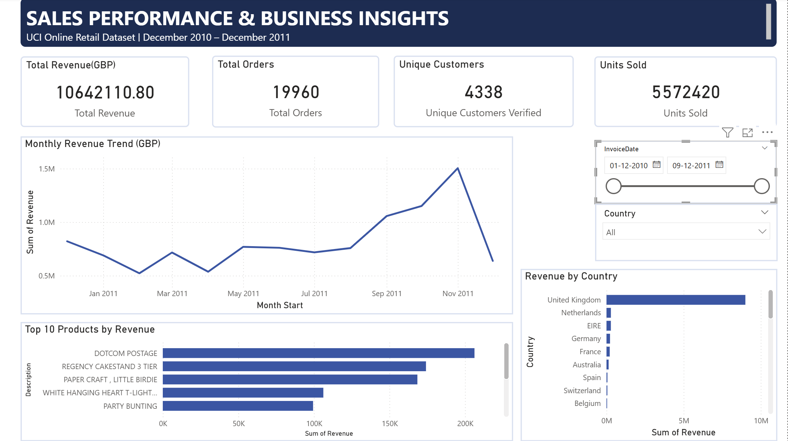

# Sales Performance & Business Insights Dashboard

An end-to-end sales analytics project built to explore retail transaction data, understand business performance, and turn raw sales records into actionable insights using **Python, SQL, Excel, and Power BI**.

The project analyzes the UCI Online Retail dataset, covering transactions from December 2010 to December 2011.

## Dashboard Preview



*Interactive Power BI dashboard with sales KPIs, monthly revenue trends, top-performing products, country performance, and date filters.*

> **Note:** Download the Power BI file below to interact with the dashboard. The screenshot above is a static preview.

## Business Overview

The goal of this project was to answer practical business questions:

- How much revenue did the business generate?
- How did sales change month over month?
- Which products and countries generated the most revenue?
- How many orders and customers were recorded?
- What patterns can be observed in sales activity?
- How concentrated was revenue among the top-performing products?

## Key Results

| KPI | Result |
|---|---:|
| Total Revenue | £10,642,110.80 |
| Total Orders | 19,960 |
| Unique Customers | 4,338 |
| Average Order Value | £533.17 |
| Units Sold | 5,572,420 |
| Products | 3,922 |
| Countries | 38 |

*Results are based on the cleaned transaction data. Revenue is calculated as Quantity × UnitPrice, in GBP.*

## Tools & Technologies

- **Python:** Data cleaning, transformation, and exploratory analysis
- **Pandas & NumPy:** Data manipulation and calculations
- **SQL (SQLite):** Business queries, aggregations, and month-over-month analysis
- **Microsoft Excel:** Summary reports and performance analysis
- **Power BI:** Interactive dashboard, KPI cards, charts, and slicers
- **Git & GitHub:** Version control and project documentation

## Dashboard Features

- **Executive KPIs:** Revenue, orders, customers, and units sold
- **Monthly Sales Trend:** Track revenue changes over time
- **Top Products:** Identify products with the highest revenue
- **Country Performance:** Compare revenue across markets
- **Interactive Filters:** Explore results by date and country

## Key Business Insights

- The United Kingdom generated approximately **£9.00 million**, making it the largest revenue-contributing country in the dataset.
- September 2011 recorded approximately **£1.06 million** in revenue, the highest monthly revenue in the analysis.
- Revenue declined by **24.25% in February 2011** compared with January, followed by a **37.06% increase in March**.
- DOTCOM POSTAGE was the highest-revenue item in the product-level analysis. This is a postage-related item, not a conventional retail product.
- Revenue was distributed across many products, with the highest-revenue item contributing approximately **1.94%** of total revenue.

These findings describe the historical dataset and should not be interpreted as forecasts of future performance.

## Project Structure

```text
Sales_Performance_Business_Insights_Dashboard/
│
├── data/
│   ├── raw/
│   │   └── sample_sales_synthetic.csv
│   └── processed/
│       ├── clean_sales.csv
│       ├── monthly_kpis.csv
│       ├── product_performance.csv
│       ├── country_performance.csv
│       ├── orders.csv
│       └── sales_analysis.db
│
├── assets/
│   └── dashboard.png
│
├── excel/
│   └── Sales_Performance_Summary.xlsx
│
├── powerbi/
│   ├── Sales_Performance_Dashboard.pbix
│   ├── DAX_measures.txt
│   └── dashboard_build_guide.md
│
├── reports/
│   └── summary.json
│
├── sql/
│   └── analysis_queries.sql
│
├── src/
│   ├── analyze_sales.py
│   └── build_excel_report.py
│
├── run_sql_analysis.py
├── requirements.txt
└── README.md
```

## How to Run the Project

### 1. Clone the repository

```bash
git clone https://github.com/rishukumar68/Sales_Performance_Business_Insights_Dashboard.git
cd Sales_Performance_Business_Insights_Dashboard
```

### 2. Create and activate a virtual environment

```bash
python -m venv .venv
```

Windows PowerShell:

```powershell
.\.venv\Scripts\Activate.ps1
```

### 3. Install dependencies

```bash
pip install -r requirements.txt
```

### 4. Add the original dataset

Download the UCI Online Retail dataset and place `Online Retail.xlsx` inside `data/raw/`.

The original dataset is not included in this repository. The synthetic sample CSV is provided for testing and demonstration.

### 5. Run the Python analysis

```bash
python src/analyze_sales.py
```

This generates cleaned sales data, KPI summaries, product and country reports, and a summary JSON file.

### 6. Run the SQL analysis

```bash
python run_sql_analysis.py
```

This loads the processed CSV into SQLite and executes the business analysis queries in `sql/analysis_queries.sql`.

### 7. Explore the reports

- Open `excel/Sales_Performance_Summary.xlsx` in Microsoft Excel.
- Open `powerbi/Sales_Performance_Dashboard.pbix` in Power BI Desktop.

## Data Cleaning & Assumptions

The analysis includes duplicate handling, required-field checks, and filtering of cancellation invoices and transactions with non-positive quantities or unit prices.

Customer IDs are not available for every transaction. Customer counts therefore include only known customer IDs. The results reflect the cleaning rules used in this project and may differ from analyses using different assumptions.

## What I Learned

Through this project, I practiced cleaning real-world transaction data, writing SQL queries for business reporting, validating KPIs across tools, and presenting analytical findings through an interactive Power BI dashboard.

## Future Improvements

- Add additional customer segmentation and retention analysis.
- Improve dashboard storytelling with more business-focused KPIs.
- Automate data refresh and report generation.
- Explore sales seasonality and repeat-purchase patterns.

## Dataset

**Source:** UCI Machine Learning Repository — Online Retail

https://archive.ics.uci.edu/dataset/352/online+retail

## Author

**Rishukumar**  
GitHub: [@rishukumar68](https://github.com/rishukumar68)

---

*This project was created for learning and portfolio demonstration purposes using historical retail transaction data.*
